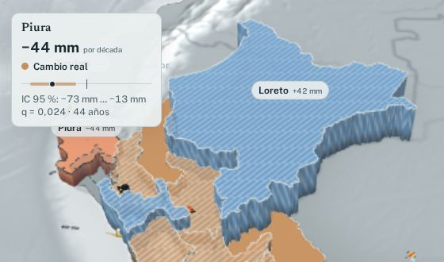
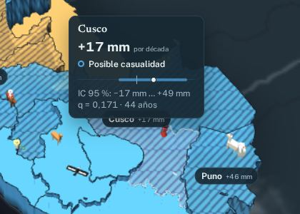
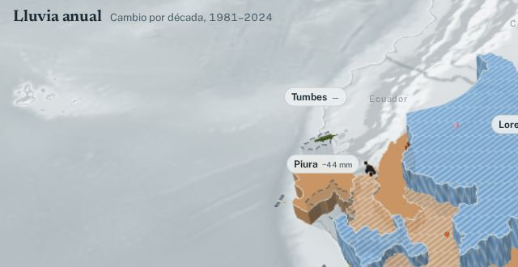
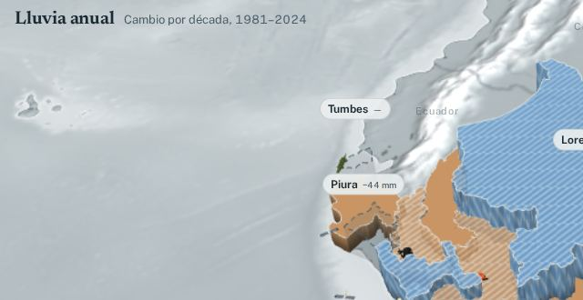

# feat/mapa-hover-relieve

PR: base `developer`. Autor: Josue.

## Resumen

El mapa 3D ahora responde mejor al puntero y se ve con más detalle, sin gastar más en reposo:

1. **Ficha técnica al pasar el puntero** por un departamento, con entrada y salida animadas. El departamento sube un poco y brilla suave.
2. **Relieve real de Sudamérica** alrededor del Perú: los Andes de Ecuador, Bolivia y Chile suben con su elevación, con color por altitud y nieve.
3. **Sombra de contacto** en las paredes de las columnas: se oscurecen junto al suelo, como una maqueta.

**No se agregó ninguna librería.** Todo usa three.js y CSS, que ya están en el stack. No cambia el contrato de datos ni las rutas. Los cambios están en `src/mapa/escena.ts`, `src/index.css` (estilos de la ficha) y 3 textos nuevos en `src/i18n/textos.ts`.

## Commits (uno por tema; cada uno se puede quitar solo)

| Commit | Qué hace |
|---|---|
| `feat(mapa): ficha técnica y resaltado suave al pasar el puntero por un departamento` | Ficha, elevación, brillo y contorno del hover. También `textos.ts` e `index.css` |
| `feat(mapa): relieve real de Sudamérica en el suelo, sin costo en equipos lentos` | Malla de relieve, color por altitud, nieve y apagado automático en equipos lentos |
| `feat(mapa): sombra de contacto en las paredes de las columnas` | Paredes más oscuras abajo, en el mismo shader |
| `docs: changelog de la rama` | Este archivo y 4 recortes en `changelog/img/` (~23 KB cada uno) |

**Probado:** revertir cada uno de los 3 primeros por separado da un revert limpio, y `tsc`, `lint` y `test` siguen en verde.

## 1. Ficha técnica al pasar el puntero

| Claro (Piura, cambio real) | Oscuro (Cusco, posible casualidad) |
|---|---|
|  |  |

**Qué muestra:**

- el nombre del departamento;
- el cambio por década (en la máquina del tiempo, la anomalía del año frente a su promedio);
- el estado, con un punto como el de la leyenda: pleno = real, anillo = posible casualidad, gris = pocos datos;
- **el rango probable (IC 95 %) dibujado frente al cero:** si la barra cruza la línea del medio, el cambio puede ser casualidad. Es el criterio de «cambio real» (`docs/tendencias.md` §2b del backend) hecho visible;
- el IC en cifras, `q` y el número de años.

**Cómo se comporta:**

- Entra con un fundido y un leve ascenso (140–200 ms) y sale igual. Solo se animan `opacity` y `transform`, que no recalculan el layout.
- El departamento sube 0,18 y su brillo de acento entra rápido y sale más lento. El contorno toma el color del texto; la zona elegida sigue con el acento.
- La ficha sigue la cara superior aunque la columna se mueva, no se sale del mapa por los lados y baja si no cabe arriba.
- Con «reducir movimiento», sin transiciones.
- Todo es `textContent`, nunca HTML.
- Cambiar el idioma, la variable o el año con la ficha abierta la actualiza.

**Costo:** el hover no recompila materiales. Solo cambia 2 contornos y llena la ficha; el brillo se interpola en el cuadro que ya se dibuja.

**Referencias:** es el patrón de `autoHighlight` + `getTooltip` de deck.gl y de `fill-extrusion` con hover de Mapbox/MapTiler: resaltar el objeto bajo el puntero y mostrar sus campos en una ficha que no captura el puntero (`pointer-events: none`). Solo los departamentos y la fauna son «elegibles»; el suelo no, como recomiendan esas guías.

## 2. Relieve real de Sudamérica

| Antes | Después |
|---|---|
|  |  |

- `public/mapa/mundo2.png` ya traía la elevación real (SRTM de NASA y ETOPO1 de NOAA) en el canal rojo, pero **la escena no la usaba**. Ahora sí:
  - **Altura:** una malla de 192 × 192 (128 × 128 en celular) solo sobre la caja de la textura. El shader de vértices la sube según la elevación, con exageración ~×11 (`RELIEVE = 1,3`).
  - **Color por altitud:** las tierras bajas, más oscuras; los Andes, más claros; nieve sobre ~4800 m.
  - **Sombreado del relieve:** el que ya venía precalculado en `mundo.png` (hillshade de `scripts/generar_mundo.py`), ahora multiplicado sobre el color.
- **Dentro del Perú no sube**, porque ahí están las columnas del dato. La máscara es la silueta del Perú, que ya se dibujaba para la sombra, ahora en un segundo canal casi nítido.
- **Sin repintar dos veces:** la malla va 1 cm sobre el mar y se dibuja antes, así la prueba de profundidad descarta esos píxeles del plano grande.
- **Equipos lentos:** si la resolución adaptativa baja de 0,7, la malla se oculta. Queda el mar plano con el mismo color y sombreado.

## 3. Sombra de contacto en las columnas

Las paredes se oscurecen hasta un 45 % junto al suelo y se aclaran en 1,4 unidades. Se hace con `onBeforeCompile` en el material que ya existía, así que no hay pasadas extra.

**Descartado:** SSAO, N8AO (`n8ao`/`postprocessing` de pmndrs) y `OutlinePass`. Agregan pasadas a pantalla completa en cada cuadro y una dependencia nueva, justo lo que la PR anterior quitó (las sombras PCF).

## Medido

Medí con `mapa-v2/bench/bench.mjs` (Chromium, 1440 × 900 a escala 1,5), con el build de `developer` contra el de esta rama:

| Fase | GPU real (AMD integrada): antes | GPU real: después | Sin GPU (SwiftShader), draw calls/s: antes | Sin GPU: después |
|---|---|---|---|---|
| Quieto | 64 % CPU | 63 % CPU | 1330 | 1652 |
| Mouse sobre el mapa | 88 % CPU | 97 % CPU | — | — |
| Zona elegida | 36 % CPU | 39 % CPU | — | — |
| Reposo largo | 36 % CPU | 38 % CPU | 1985 | 2012 |

- **En reposo cuesta lo mismo.** Con GPU real se mantienen los 60 cuadros/s.
- **Con el mouse en movimiento, +9 puntos de CPU.** Viene de la ficha: unos 12 layouts/s al pasar rápido por varios departamentos (se mide al llenarla) y de la animación de elevación y brillo.
- **Sin GPU:** la primera versión del relieve (256 × 256, siempre visible) bajaba los cuadros a la mitad. Con 192 × 192 y el apagado automático, queda igual o mejor que antes.

`pnpm lint`, `pnpm build`, `pnpm test` (16) y `pnpm e2e` (4) pasan en local. Sin errores de shader en la consola, en tema claro y oscuro.

## Cómo probar

```bash
pnpm install
pnpm dev   # abrir /#explorar
```

Qué mirar:

1. Pasar el puntero por Piura y por Cusco: la ficha entra suave, la columna sube y la barra del IC cruza el cero solo en Cusco.
2. Mover el mapa con la ficha abierta: la ficha sigue a la columna y no se sale por los bordes.
3. En la máquina del tiempo, elegir un año: la ficha muestra la anomalía del año.
4. Mirar Ecuador, Bolivia y Chile: se ve el relieve y la nieve en los picos. Cambiar el tema.
5. Con «reducir movimiento» activado en el sistema: sin transiciones.

## Pendiente (otra PR)

- **En pantalla táctil no hay ficha**, porque no hay puntero que pase por encima. Al tocar se elige la zona y se abre la ficha lateral, como antes.
- **En la máquina del tiempo**, `q` y los años de la ficha son de la tendencia, no del año.
- **Ancho fijo de la ficha:** evitaría medirla en cada cambio de hover (los ~12 layouts/s).
- **Revisar con el equipo el tono de la nieve en el tema claro:** se confunde un poco con la tierra alta.
